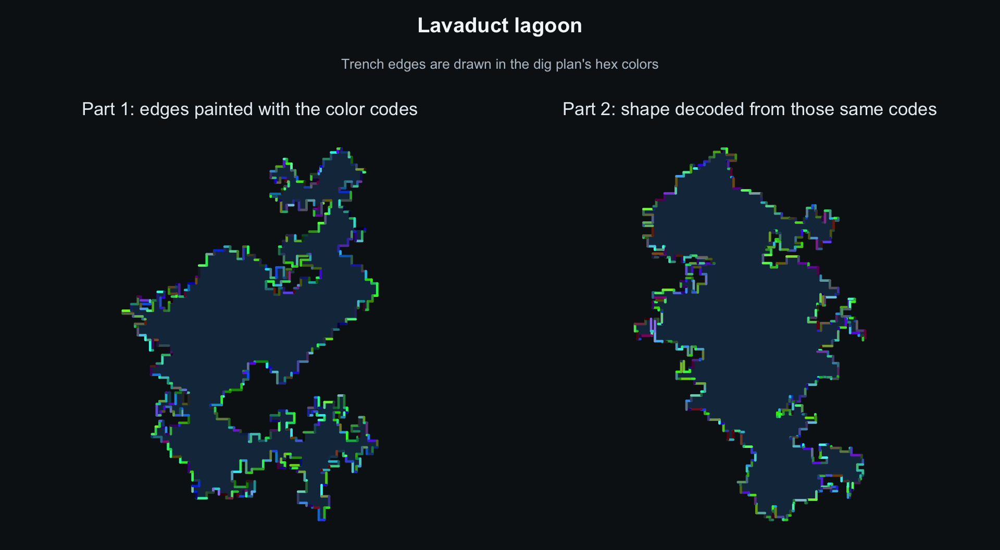

## Advent of Code 2023 - R solutions[^1]


```bash
# Run a specific day
pixi run aoc <day>
```

## Bonus
Day 18 draws the lavaduct lagoon in `plots/day_18_lagoon.png`. Each trench edge uses the hex color from that line of the dig plan. 
The left loop is the part 1 plan and the right loop is the part 2 shape decoded from those same hex codes:



[^1]: Requires [pixi](https://pixi.sh) to be installed.
